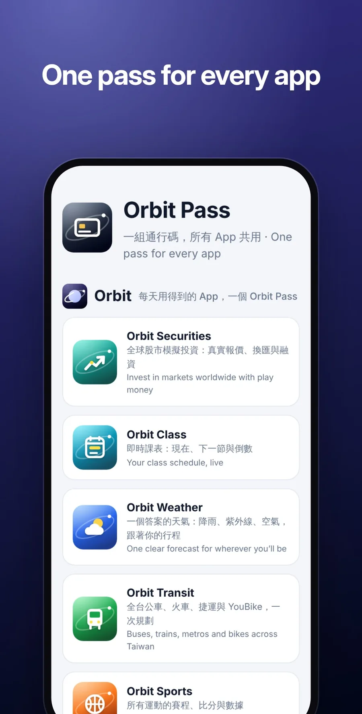
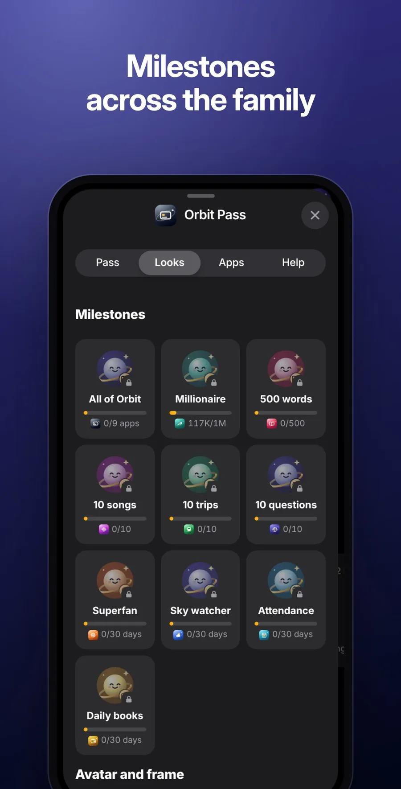
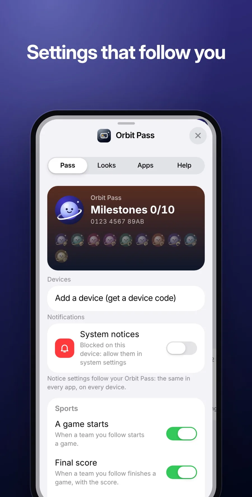

<p align="center">
  
</p>

<h1 align="center">Orbit-Core</h1>

<p align="center">
  <b>The engine room behind every Orbit app.</b><br>
  <a href="https://orbit.jaypengx.com/app/"><b>Use Orbit</b></a> · <a href="https://orbit.jaypengx.com/pass/">orbit.jaypengx.com</a> · proxy at <code>api.jaypengx.com</code>
</p>

<p align="center">
     
</p>

The Orbit apps are static sites. Everything server-side, plus the kit and brand they all share, lives here: the proxy, the Orbit Pass account, notices, data builds, and the family's home page.

<p align="center">
  
  
  
</p>

## Use Orbit

**[Orbit](https://orbit.jaypengx.com/app/)** is the way to use the family: one home-screen app with every app inside, signed in once, switching between them without reloading. Open [orbit.jaypengx.com/app](https://orbit.jaypengx.com/app/) on your phone and add it to the home screen. Each app below also works on its own, for anyone who wants just one; it suggests Orbit now and then, which one tap turns off.

## The family

| App | On its own | What it is |
| --- | --- | --- |
| [Orbit Sports](https://github.com/JayPengX/Orbit-Sports) | [orbit.jaypengx.com/sports](https://orbit.jaypengx.com/sports/) | Every game, live |
| [Orbit Transit](https://github.com/JayPengX/Orbit-Transit) | [orbit.jaypengx.com/transit](https://orbit.jaypengx.com/transit/) | Bus, train and bike |
| [Orbit Weather](https://github.com/JayPengX/Orbit-Weather) | [orbit.jaypengx.com/weather](https://orbit.jaypengx.com/weather/) | One clear forecast |
| [Orbit Words](https://github.com/JayPengX/Orbit-Words) | [orbit.jaypengx.com/words](https://orbit.jaypengx.com/words/) | English words that stay |
| [Orbit Securities](https://github.com/JayPengX/Orbit-Securities) | [orbit.jaypengx.com/securities](https://orbit.jaypengx.com/securities/) | Invest worldwide, risk-free |
| [Orbit Class](https://github.com/JayPengX/Orbit-Class) | [orbit.jaypengx.com/class](https://orbit.jaypengx.com/class/) | Today's classes at a glance |
| [Orbit Beats](https://github.com/JayPengX/Orbit-Beats) | [orbit.jaypengx.com/beats](https://orbit.jaypengx.com/beats/) | Make your own beats |
| [Orbit Law](https://github.com/JayPengX/Orbit-Law) | [orbit.jaypengx.com/law](https://orbit.jaypengx.com/law/) | Laws, rulings, bills |
| [Orbit Money](https://github.com/JayPengX/Orbit-Money) | [orbit.jaypengx.com/money](https://orbit.jaypengx.com/money/) | Every dollar, in its place |
| [Orbit News](https://github.com/JayPengX/Orbit-News) | [orbit.jaypengx.com/news](https://orbit.jaypengx.com/news/) | One story, every side |

The family page and Orbit Pass sign-in are at [orbit.jaypengx.com/pass](https://orbit.jaypengx.com/pass/); how it's all built, in pictures and numbers, is at [jaypengx.com/showcase](https://jaypengx.com/showcase/).

## Features

- **The proxy** (`api.jaypengx.com`): one Cloudflare Worker for every live read the apps make (sports, transit, weather, markets, law, Class's planes in the air, 立法院's live sittings), answering at each app's own address (`orbit.jaypengx.com/api`, so no cross-site calls), with the apps' AI features behind it, so no key ever reaches a phone.
- **Orbit AI, one door for every app** (`/ai`): each feature named, its prompt fixed on the server, its input lean, its answer's shape checked, a cap a day; when something is missing it asks back with options. Code first: what code can read or add up, it does, and the AI gets a small digest and writes a line; answers are drawn (logos, faces, tiles, bars) under Orbit AI's mark, never a paragraph. Each model is backed by one of its class from another maker (Claude, GPT, Gemini), and what everyone reads (game recaps, F1's deciding moments, each side's angle on the news, word cards, Law's explanations) is made once ahead by the builders.
- **The family notebook** (`kit/family.mjs`, on the phone only): apps tell each other what helps (Weather where rain is due, Class the next classes, Securities the names held, Words the words being learned), so Transit avoids rain, News leads with what you follow, and the Pass's 今天 sums up the day; 問 Orbit on the Pass opens the app that answers a question, asked there.
- **The Orbit Pass:** one sign-in and one wallet for every app, with each app's saved data, kept in Cloudflare D1.
- **Notices** that reach a phone while the app is closed: game starts, class reminders, bus arrivals, rain, price alerts.
- **Data builds** on the proxy's cron into Cloudflare R2: seasons, game days, bus routes and shapes, photos, highlights, the news stories and CWA's rain radar.
- **Runs for NT$0:** the domain is the only thing paid for. The proxy lives inside Cloudflare's Workers Free plan (its heavy routes and the crons' work in the Runner, a Durable Object), and Transit reads the operators' own sites first (台鐵, 高鐵, each city's buses, the metros, YouBike), most of them straight from the phone, with TDX's free tier only as a backup.
- **External sources' health** (admin 健康 › 外部來源): every outside source counted from the calls the apps make anyway, so a broken one shows.
- **The kit:** the shared look (an iOS-style design system) on every screen either way up (a phone upright or on its side, a tablet, a computer: the tab bar becomes a rail at the side, sheets centred cards, pages in columns), the sign-in sheet, sheets, tab bars, the date strip, offline handling, the service worker and the helpers every app loads.
- **Add to Home Screen** steps written for the phone's own browser (Safari, iPad, Chrome on iPhone, Android Chrome, Samsung Internet, LINE and other in-app browsers), in Chinese and English.
- **Recommendations that learn** (`kit/feedback.mjs`): what a list of picks showed and what was opened from it, kept on the phone for 30 days, so picks you pass over sink.
- **The site publisher** (`deploy/cf-site.mjs`): every repo's push puts its site on Cloudflare at its short orbit.jaypengx.com address (Jay's homepage at jaypengx.com), served as static files.
- **A cost guard** that reads the use every five minutes and paces the proxy through a UTC day's Free-plan amounts, slowing down rather than stopping.
- **Passes for a crowd:** priority passes and a fair door when too many come at once, and 公開領取, a page that hands a pass to whoever scans its QR code.
- **Links out** of a Home Screen app one way for every app: iOS's quick view, or the Safari app if chosen on the Pass.
- **Brand:** every app's icon, share card and manifest generated from one file.
- **Tools:** a phone-sized preview of any app with real data, and the audits and list builders the apps rely on.

## Tech stack

| Layer | What |
| --- | --- |
| Workers | Cloudflare Workers, plain JavaScript (ES modules), no runtime dependencies |
| Storage | D1 (`orbit-store`: the Pass, notices), R2 (`orbit-data`: built data and kept reads), KV (caches and limits), Durable Objects (the Runner, the door, the guard's clock, F1 timing log) |
| AI | Claude, GPT and Gemini on one door (`/ai`), through `gemini-relay`, pinned to Taiwan |
| Kit and site | Cloudflare: `kit/` and `site/` (the family page and the admin page) |
| CI/CD | GitHub Actions: tests, then Wrangler deploys from `main` |
| Tools | Node.js 22 and Playwright (Chromium and WebKit) |
| Tests | `node --test` on the Pass, the money, notices, the data proxy, builders, the guard and the kit |

## How it works

```
phones (home-screen apps) ── each app's static files + the kit (#kit/…, from this repo's site)
   │  memory → Cache Storage → localStorage (versioned keys)
   ▼
orbit-workers-proxy (one Worker)
   /eco           the Orbit Pass: accounts, wallet, app data (D1)
   /stock         Securities' orders filled at the proxy's quote
   /push          notices while an app is closed (KV + cron)
   /weather       Google + CWA + MOENV blended (KV cells)
   /transit       the operators' own sites first (transit-free.js), TDX's free tier as backup, Google Maps / Places / Routes
   /sports-proxy  live data reads for the apps, by host, trimmed and cached
   /ai            every app's AI by feature name (Claude, GPT, Gemini via gemini-relay)
   /gemini, /nl-edit, /law-ask, /law-chat   Class's import, Law's questions
   /data          the family's data in R2, built by builders/ on the cron (News's stories too)
   /cal           Class's timetable as a calendar subscription
   /showcase/pass a short read-only pass for the showcase's live demos
quota-guard   reads the use every 5 minutes; paces the proxy through the Free plan's day
orbit-<app>   each app's static files at orbit.jaypengx.com/<app>/ (orbit-pass: the kit and /pass/, orbit-home: jaypengx.com)
orbit-site    holds the hostnames; longshot.jaypengx.com's shutdown notice
```

A read from an app goes down these layers until one answers: memory, the phone's Cache Storage, the family's data in R2, the proxy's edge cache, reads kept for good in R2, and only then the upstream. A failed read is a failure, never "nothing there".

The kit is **served, not copied**: apps load it from this repo's site through an import map (`#kit/…`), every file addressed by its content hash, so a kit change is one push here and a phone downloads only what changed.

Every route, data layer, sync path, component pattern, secret and deploy: **[MAP.md](MAP.md)**, the family's map ([CLAUDE.md](CLAUDE.md) is where every session starts).

## Project structure

```
worker.js            the proxy's router; each route's work in its own file:
├── eco.js, eco-admin.js, orbit-token.js       the Orbit Pass and its admin
├── push.js                                    notices
├── weather.js, weather-skill.js, weather-radar.js, typhoon.js   weather
├── transit.js, transit-free.js                transit (the operators' own sites first)
├── sports.js, sports-today.js, f1-live.js, asia-baseball.js
├── stock-fill.js, stock-check.js, fund-nav.js, taifex.js   Securities
├── money.js, money-read.js                 Money
├── law.js, law-chat.js, law-ground.js, law-more.js, law-page.js, law-hosts.js
├── cal.js (Class's calendar), gift.js (公開領取), showcase.js (the showcase's pass)
├── runner.js (heavy routes and crons in a Durable Object), door.js, sources.js
└── data.js, http.js, capacity.js, pace.js, ops.js, doc-store.js, store-backup.js
gemini-relay.js      Gemini, pinned to Taiwan
guard.js             the cost guard (its own Worker)
site.js              the site Worker (orbit.jaypengx.com, jaypengx.com; longshot.jaypengx.com's shutdown notice)
builders/            data builds into R2 (seasons, buses from GTFS, photos, highlights, news…)
kit/                 the shared kit every app loads
site/                the family page and the admin page
brand/               icons, share cards and manifests for every app
locales/             shared text
tools/               preview.mjs and the other tools (tools/README.md)
tests/               node --test
docs/                RULEBOOK.md (how to work, every rule), DESIGN.md (how screens look)
wrangler*.toml       one per Worker
```

## Getting started

Requirements: Node.js 22 or newer; Playwright for the preview tool.

```bash
git clone https://github.com/JayPengX/Orbit-Core.git
cd Orbit-Core
npm test
```

Preview any app at phone size with real data, with the app's repo cloned beside this one:

```bash
git clone https://github.com/JayPengX/Orbit-Sports.git ../Orbit-Sports
node tools/preview.mjs sports --live --width 375
```

Apps: `sports`, `transit`, `weather`, `words`, `securities`, `orbit` (Class), `beats`, `law`, `money`, `news`, and `admin` (the admin page on made-up accounts). Every flag is in [tools/README.md](tools/README.md).

Regenerate the brand after changing a name or colour:

```bash
node brand/generate.mjs
node tools/accent-css.mjs
```

## Deploying

Push to `main`. GitHub Actions runs the tests and deploys:

| Workflow | What |
| --- | --- |
| `deploy.yml` | The proxy, `gemini-relay` and the site Worker, and attaches the jaypengx.com hostnames |
| `deploy-guard.yml` | The cost guard, when its files change |
| `pages.yml` | The kit and `site/` to Cloudflare |
| `news-site.yml` | Orbit News's site to Cloudflare (started by the proxy's news build) |
| `buses.yml` | The weekly bus packs from TDX's GTFS |
| `build.yml`, `tail.yml`, `audit.yml` | By hand: run a builder, watch the logs, check secret names |

Secrets live only as GitHub or Cloudflare secrets, never in the repo.
